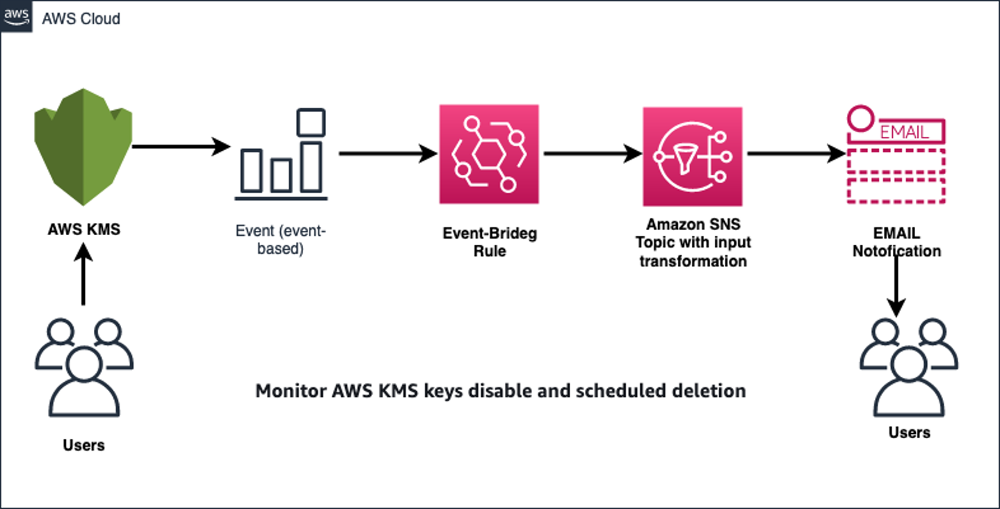

# Monitor AWS KMS keys disable and scheduled deletion

> **Disclaimer:** This is sample code for non-production usage. Work with your security and legal teams to meet your organizational security, regulatory and compliance requirements before deployment. See [SECURITY.md](SECURITY.md) for the services used, permissions, accepted trade-offs and clean-up steps.

## **Summary**

Deleting an AWS KMS key is destructive and potentially dangerous. It deletes the key material and all metadata associated with the KMS key and is irreversible. After a KMS key is deleted, you can no longer decrypt the data that was encrypted under that KMS key, which means that data becomes unrecoverable.

This pattern explains how to monitor AWS KMS key state by combining Amazon EventBridge and Amazon SNS. You get an email when a KMS key is disabled or scheduled for deletion, and when a scheduled deletion completes. After you receive the notification, you can reconsider your decision to delete the key or re-enable a disabled key.

## **Prerequisites**

- An active AWS account with an AWS Identity and Access Management (IAM) role or user that can create CloudFormation stacks, KMS keys, SNS topics and EventBridge rules.
- Understanding of the following AWS services:
  - Amazon EventBridge and the EventBridge input transformer
  - AWS KMS
  - Amazon Simple Notification Service (Amazon SNS)
- AWS CloudTrail turned on for management events. A trail is recommended so that failed (denied) calls and a long history are available. See the [CloudTrail documentation](https://docs.aws.amazon.com/awscloudtrail/latest/userguide/cloudtrail-create-and-update-a-trail.html).

## **Limitations**

- The rules are Regional. Deploy the stack in each AWS Region where you have KMS keys.
- The `ScheduleKeyDeletion` and `DisableKey` alerts are based on CloudTrail management events, so they arrive within a few minutes, not instantly.
- Failed attempts (for example, a request that was denied or that targets a key in the wrong state) also send an email. The last line of the message shows the error code. It is empty if the request succeeded.

## **Target architecture**



- A user disables an AWS KMS key or schedules its deletion. When the waiting period ends, AWS KMS deletes the key and sends its own event.
- An EventBridge rule matches the event.
- The EventBridge rule publishes a message to an Amazon SNS topic that is encrypted with a customer managed key.
- An email notification is sent to the subscribed address.

The stack creates one KMS key for the topic. Amazon EventBridge cannot publish to a topic that uses the AWS managed key `alias/aws/sns`, because that key policy cannot be changed. If anyone disables or deletes the topic key, the alerts stop. The rules in this stack also fire for that key.

## **Tools**

- [Amazon EventBridge rules](https://docs.aws.amazon.com/eventbridge/latest/userguide/eb-rules.html) - A rule matches incoming events and sends them to targets for processing. A single rule can send an event to multiple targets, which then run in parallel. Rules are based either on an event pattern or a schedule.
- [AWS CloudFormation](https://aws.amazon.com/cloudformation/) - AWS CloudFormation is an infrastructure as code (IaC) service that allows you to easily model, provision, and manage AWS and third-party resources.
- [AWS KMS](https://aws.amazon.com/kms/) - AWS Key Management Service (AWS KMS) is a managed service for creating and controlling AWS KMS keys, the encryption keys used to encrypt your data.
- [Amazon SNS](https://aws.amazon.com/sns/) - Amazon Simple Notification Service (Amazon SNS) is a managed service that provides message delivery from publishers to subscribers (also known as producers and consumers). Publishers communicate asynchronously with subscribers by sending messages to a topic, which is a logical access point and communication channel.

## **Steps to Deploy**

1. Clone this repository to your local workstation.
2. Deploy `Alerting-KMS-Events.yaml` in the account and Region where you want the alerts. In the CloudFormation console, enter your email address for `DestinationEmailAddress` and a topic name for `SNSTopicName`. With the AWS CLI:

   ```bash
   aws cloudformation deploy \
     --stack-name kms-key-state-alerts \
     --template-file Alerting-KMS-Events.yaml \
     --parameter-overrides DestinationEmailAddress=you@example.com SNSTopicName=kms-key-state-alerts
   ```

3. Open the subscription confirmation email from Amazon SNS and confirm the subscription. You receive no alerts until you confirm.

## **Test**

1. Create a test KMS key, or pick a key that you do not use.
2. Disable it (`aws kms disable-key --key-id <key-id>`). You should get an email within a few minutes.
3. Re-enable it (`aws kms enable-key --key-id <key-id>`).

## **Cost**

The customer managed key costs about USD 1 per month plus request charges (see [AWS KMS pricing](https://aws.amazon.com/kms/pricing/)). SNS email delivery, EventBridge rules for AWS service events, and the CloudFormation stack have no or very low cost for this volume.

## **Clean up**

Delete the CloudFormation stack. The topic key goes into a pending deletion period (30 days by default) and is then removed. Delete or cancel any test keys that you created.

## Security

See [CONTRIBUTING](CONTRIBUTING.md#security-issue-notifications) for more information, and [SECURITY.md](SECURITY.md) for the security considerations of this sample.

## License

This library is licensed under the MIT-0 License. See the [LICENSE](LICENSE) file.
